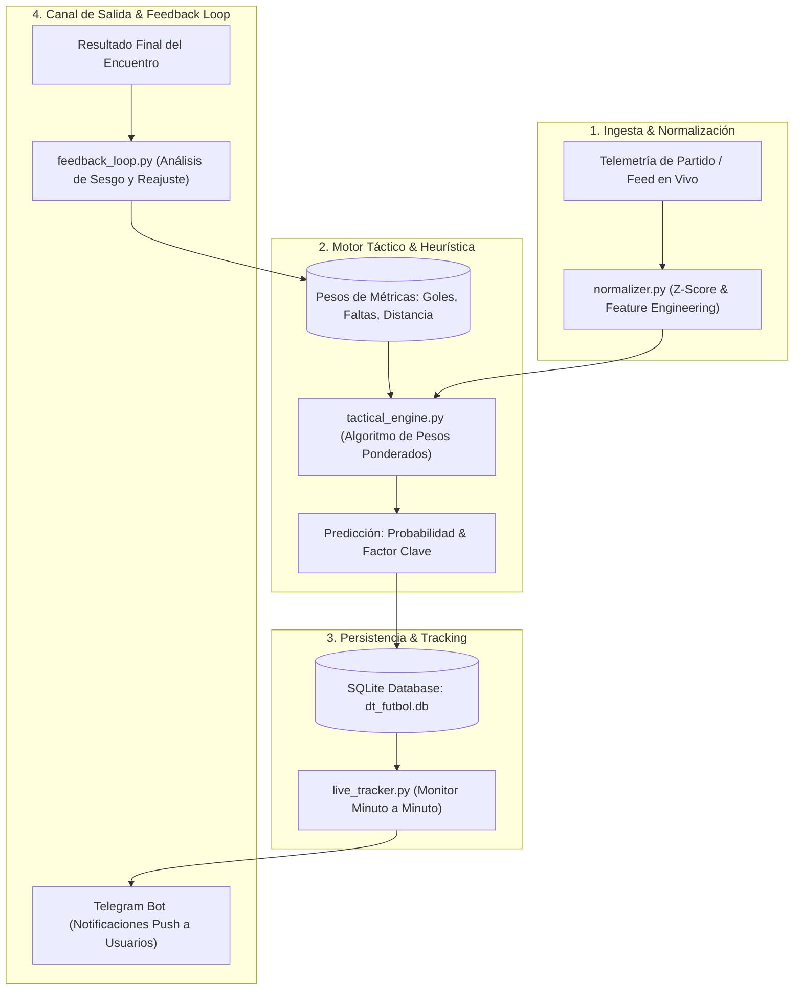

# ⚽ DT Fútbol Analytics & Tactical AI Prediction Engine

[](https://python.org)
[](https://sqlite.org)
[](https://telegram.org)
[](https://docker.com)

Sistema integral de analítica táctica deportiva, modelado predictivo probabilístico y seguimiento en tiempo real para encuentros de fútbol profesional, integrado con bot automatizado en Telegram y ciclo continuo de retroalimentación de sesgo (*Feedback Loop Engine*).

---

## 🎯 Arquitectura del Sistema



---

## 🚀 Características Técnicas

- **🧠 Motor Ponderado Heurístico:** Evalúa métricas avanzadas por encuentro (tasa de conversión, distancia de recorrido, faltas tácticas, historial de goles recientes) asignando ponderaciones dinámicas parametrizadas.
- **🔄 Bucle de Aprendizaje y Feedback Continuo:** Si una predicción diverge del resultado real, el módulo `feedback_loop.py` diagnostica el sesgo cognitivo/estadístico y ajusta la tabla `feature_weights` para refinar predicciones subsecuentes.
- **⏱️ Rastreador en Vivo (Live Tracker):** Monitorea eventos minuto a minuto durante los partidos activos y despacha alertas automáticas al canal de Telegram asociado.
- **💾 Modelo Relacional Ligero:** Estructura en SQLite con índices en `partido_id`, `chat_id` y tablas dedicadas de auditoría `feedback_logs`.

---

## 🛠️ Instalación y Uso

### 1. Clonar el repositorio
```bash
git clone https://github.com/elburgos2000/dt-futbol-analytics.git
cd dt-futbol-analytics
```

### 2. Configurar entorno virtual
```bash
python -m venv .venv
# En Windows:
.venv\Scripts\activate
# En Linux/macOS:
source .venv/bin/activate

pip install -r requirements.txt
```

### 3. Variables de entorno
Copiar plantilla de configuración y asignar credenciales:
```bash
cp .env.example .env
```

### 4. Ejecución del Bot
```bash
python bot.py
```

---

## 👨‍💻 Autor

**Brayan Burgos Palomino**  
- **Rol:** Software Engineer & BI Analyst  
- **GitHub:** [@elburgos2000](https://github.com/elburgos2000)  
- **Email:** [motocrossloco@gmail.com](mailto:motocrossloco@gmail.com)  
